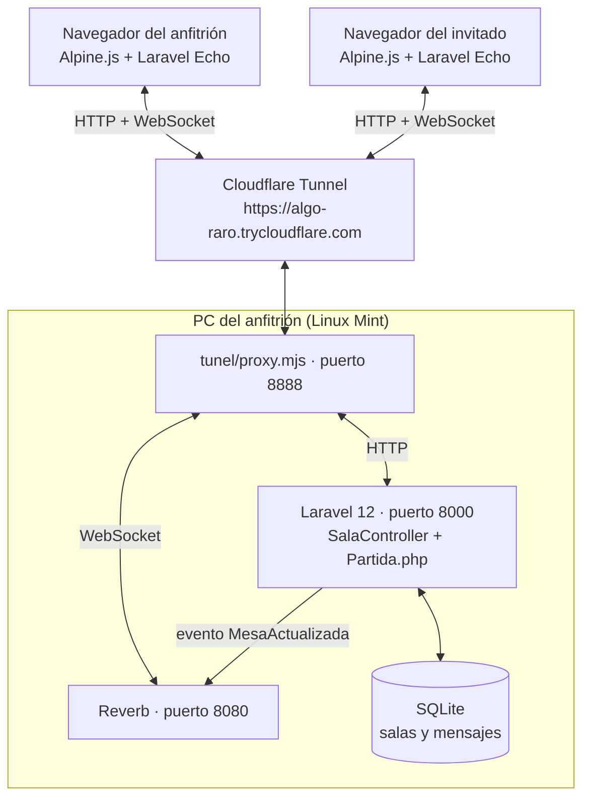
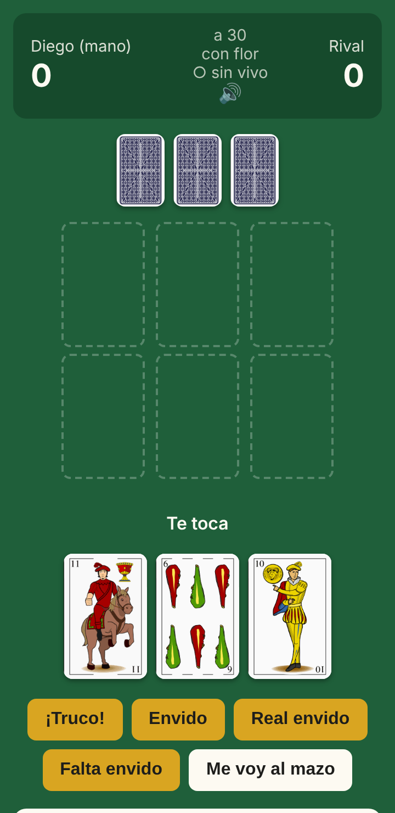
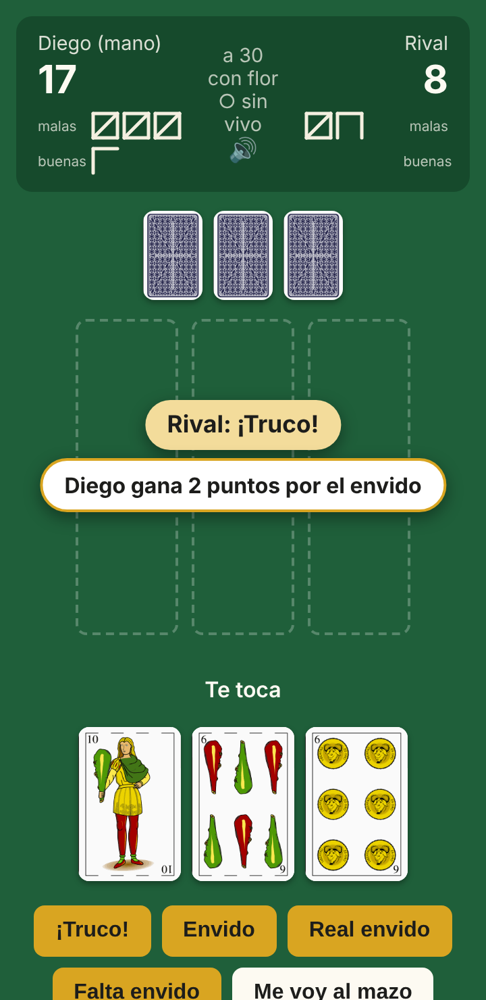
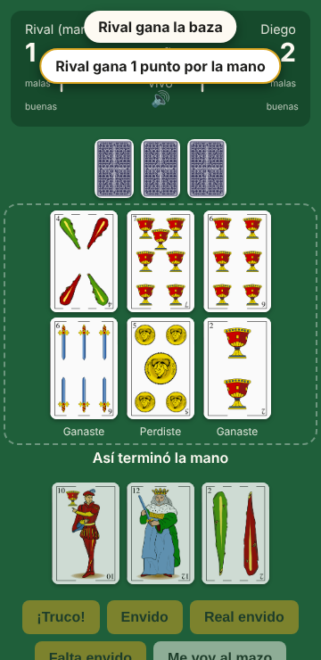

# Informe del proyecto: Vale 4 Hasta tu Saco

| | |
| --- | --- |
| **Proyecto** | Vale 4 Hasta tu Saco: truco argentino para dos jugadores en tiempo real |
| **Carrera** | Tecnicatura Universitaria en Programación |
| **Institución** | UTN Facultad Regional Resistencia, subsede Formosa |
| **Materia** | Programación IV, Unidad 4: WebSockets con Laravel (Reverb + Echo) |
| **Docentes** | Germán Crozy y Fernando Aguirre |
| **Autor** | Diego Fabian Cardozo |
| **Versión** | 1.0.0 |
| **Repositorio** | https://github.com/diegofcfor-cell/vale_4_hasta_tu_saco |

---

## Índice

1. [Resumen](#1-resumen)
2. [Introducción](#2-introducción)
3. [Objetivos](#3-objetivos)
4. [Marco teórico](#4-marco-teórico)
5. [Análisis](#5-análisis)
6. [Diseño](#6-diseño)
7. [Implementación](#7-implementación)
8. [Pruebas](#8-pruebas)
9. [Resultados](#9-resultados)
10. [Instalación y uso](#10-instalación-y-uso)
11. [Problemas encontrados y cómo se resolvieron](#11-problemas-encontrados-y-cómo-se-resolvieron)
12. [Limitaciones y mejoras futuras](#12-limitaciones-y-mejoras-futuras)
13. [Conclusiones](#13-conclusiones)
14. [Bibliografía y recursos](#14-bibliografía-y-recursos)
15. [Anexos](#15-anexos)

---

## 1. Resumen

Vale 4 Hasta tu Saco es un juego de mesa con cartas españolas, el truco típico de Argentina, para dos jugadores que juegan cada uno desde su PC o su celular. Uno de los jugadores levanta el sistema en su computadora, crea una mesa y le manda un link al rival. Desde ese momento los dos ven la misma partida y cada jugada aparece al instante en la otra pantalla, sin recargar la página. Además pueden chatear con frases típicas del truco o con texto libre.

El sistema está hecho con PHP 8.2+ y Laravel 12. El tiempo real se resuelve con Laravel Reverb (servidor de WebSockets) y Laravel Echo (cliente en el navegador), que es el contenido de la Unidad 4 de Programación IV. Para jugar entre dos casas distintas se usa un túnel gratuito de Cloudflare, sin configurar el router ni pagar un hosting.

La versión 1.0.0 implementa el reglamento completo del truco para dos (truco, envido, flor, irse al mazo, bazas pardas) y está cubierta por tests automáticos que corren en GitHub Actions.

## 2. Introducción

### 2.1 Contexto

En la Unidad 4 de Programación IV se vio cómo Laravel puede emitir eventos que llegan a los navegadores en el momento, usando WebSockets. El ejemplo de la cátedra (emisor y receptor) manda un texto de una pestaña del navegador a otra.

Este trabajo toma esa misma idea y la lleva a un caso real y exigente: un juego por turnos entre dos personas que están en lugares distintos. Un juego de cartas es un buen caso de prueba porque obliga a resolver tres problemas a la vez:

- **Tiempo real:** la jugada del rival tiene que aparecer sola, sin que el jugador recargue la página.
- **Información privada:** cada jugador tiene que ver sus cartas pero nunca las del otro.
- **Reglas:** el servidor tiene que decidir qué jugadas son válidas, para que nadie pueda hacer trampa desde el navegador.

### 2.2 Por qué el truco

El truco es el juego de cartas más popular de Argentina y tiene reglas ricas (cantos que se encadenan, puntos que dependen del momento de la mano, empates en las bazas). Programarlo bien obliga a modelar un estado complejo y a validarlo con tests, que son habilidades centrales del desarrollo de software.

## 3. Objetivos

### 3.1 Objetivo general

Desarrollar una aplicación web en Laravel 12 que permita a dos personas jugar al truco en tiempo real, cada una desde su propio dispositivo, aplicando los conceptos de broadcasting con Laravel Reverb y Laravel Echo.

### 3.2 Objetivos específicos

1. Implementar las reglas del truco para dos jugadores en clases PHP independientes del framework, y verificarlas con tests unitarios.
2. Permitir crear una mesa y compartirla con un link, sin necesidad de registro de usuarios.
3. Transmitir cada jugada en tiempo real a la otra pantalla mediante WebSockets, sin exponer las cartas del rival.
4. Incluir un chat con frases predeterminadas del truco y texto libre.
5. Permitir jugar desde dos casas distintas usando un túnel, sin costo.
6. Documentar el sistema (requerimientos, manual de usuario, diagramas de flujo e informe) y automatizar las pruebas con integración continua.

## 4. Marco teórico

Antes de describir el sistema, un repaso de los conceptos en los que se apoya. Cada uno se explica con más detalle en el [documento de requerimientos](requerimientos.md#2-conceptos-que-usa-el-sistema).

| Concepto | Qué es | Cómo se usa en el proyecto |
| --- | --- | --- |
| **HTTP** | Protocolo de pedido y respuesta: el navegador pregunta y el servidor contesta. El servidor no puede hablar primero. | Cargar la mesa, mandar una jugada, pedir el estado de la partida. |
| **WebSocket** | Una conexión que queda abierta entre navegador y servidor. Por ella el servidor puede avisar algo en cualquier momento. | Avisar a la otra pantalla que hubo una jugada. |
| **Broadcasting** | El mecanismo de Laravel para publicar eventos hacia los navegadores. Un evento implementa `ShouldBroadcast` o `ShouldBroadcastNow`. | El evento `MesaActualizada` se emite después de cada jugada. |
| **Canal** | El "tema" al que se suscribe el navegador. Puede ser público, privado o de presencia. | Un canal público por mesa: `sala.{codigo}`. |
| **Laravel Reverb** | El servidor de WebSockets oficial de Laravel. Es un proceso aparte (puerto 8080). | Reparte el aviso a las dos pantallas de la mesa. |
| **Laravel Echo** | Librería JavaScript que se conecta a Reverb y escucha eventos. | La mesa escucha `.mesa.actualizada` y pide su vista. |
| **MVC** | Patrón Modelo, Vista, Controlador, que separa datos, pantalla y lógica de control. | `Sala` y `Mensaje` (modelos), `SalaController` (controlador), vistas Blade. |
| **Túnel** | Servicio que le da a una PC una dirección pública de internet sin abrir puertos en el router. | Cloudflare Tunnel (`cloudflared`) publica el puerto 8888. |
| **Proxy inverso** | Programa que recibe las conexiones y las reenvía al servicio que corresponde. | `tunel/proxy.mjs` separa HTTP (a Laravel) de WebSocket (a Reverb). |
| **Integración continua** | Correr los tests automáticamente en cada cambio que se sube al repositorio. | GitHub Actions corre los tests con PHP 8.3 y 8.4. |

## 5. Análisis

### 5.1 Alcance

**Incluye:** crear una mesa e invitar con un link; partida completa a 15 o 30 puntos, con o sin flor; actualización en tiempo real; chat; juego entre dos casas mediante un túnel.

**No incluye:** registro de usuarios, partidas de cuatro o seis jugadores, ranking o historial, ni publicación en un hosting permanente.

### 5.2 Actores

| Actor | Rol |
| --- | --- |
| Anfitrión | Levanta el sistema en su PC, crea la mesa y comparte el link. Ocupa el asiento 0. |
| Invitado | Abre el link desde su navegador y ocupa el asiento 1. No instala nada. |
| Servidor Laravel | Valida cada jugada con las reglas, guarda la partida y emite el aviso. |
| Reverb | Reparte el aviso por WebSocket a las pantallas de la mesa. |

### 5.3 Requerimientos

El sistema tiene 19 requerimientos funcionales y 10 no funcionales, detallados con su ubicación en el código en el [documento de requerimientos](requerimientos.md). Los más importantes son:

- **RF-05:** cada jugador ve sus tres cartas y solo el dorso de las del rival.
- **RF-11:** solo se muestran los botones de las acciones permitidas, y el servidor rechaza cualquier acción inválida con el motivo.
- **RF-16:** el chat permite frases predeterminadas del truco y texto libre de hasta 200 caracteres.
- **RF-17:** cada jugada, mensaje o entrada del rival se ve en la otra pantalla sin recargar.
- **RF-19:** se puede jugar desde dos casas distintas con el link del túnel.
- **RNF-02:** las cartas del rival nunca viajan al navegador del otro jugador.
- **RNF-03:** si Reverb se cae, el juego sigue funcionando.
- **RNF-04:** dos jugadas simultáneas no pueden pisar la partida.

## 6. Diseño

### 6.1 Arquitectura general

Todo corre en la PC del anfitrión. Los navegadores de los dos jugadores entran por el túnel de Cloudflare, que llega a un único puerto (8888). Desde ahí un proxy reparte: los pedidos HTTP van a Laravel y las conexiones WebSocket van a Reverb.



### 6.2 Capas del sistema

El código está separado en tres capas, de modo que cada una se pueda entender y probar por separado:

| Capa | Dónde está | Responsabilidad | Depende de Laravel |
| --- | --- | --- | --- |
| **Dominio (reglas del juego)** | `app/Truco/` | Mazo, jerarquía de cartas, turnos, bazas, cantos y puntos. | No |
| **Aplicación web** | `app/Models/`, `app/Http/Controllers/`, `app/Events/`, `routes/` | Mesas, asientos por sesión, validación de entradas, persistencia y aviso por Reverb. | Sí |
| **Presentación** | `resources/views/`, `resources/js/` | La mesa en pantalla con Blade y Alpine.js, escucha de Echo, voz y chat. | Sí (Blade) |

La decisión más importante del diseño es que **las reglas del truco no saben que existe Laravel**. La clase `Partida` recibe una acción, la valida y cambia su estado; el controlador solo la carga, le pasa la jugada, la guarda y avisa. Esto permite probar todo el reglamento con tests unitarios sin base de datos ni servidor.

### 6.3 Flujo de una jugada en tiempo real

```
Jugador A (navegador)                Laravel                 Reverb            Jugador B (navegador)
        │  POST /sala/{codigo}/accion   │                       │                        │
        │──────────────────────────────>│ valida y guarda       │                        │
        │                               │ MesaActualizada ─────>│                        │
        │<── vista de A (JSON) ─────────│                       │── "mesa.actualizada" ─>│
        │                               │                       │   (sin datos)          │
        │                               │<──────── GET /sala/{codigo}/estado ────────────│
        │                               │──────── vista de B (JSON) ────────────────────>│
```

1. A toca una carta o un canto y el navegador manda un `POST`.
2. Laravel valida la jugada con `Partida`, la guarda y emite `MesaActualizada`.
3. Reverb reparte el aviso a quienes escuchan el canal `sala.{codigo}`.
4. Echo, en la pantalla de B, recibe el aviso y pide `GET /sala/{codigo}/estado`.
5. Laravel arma la vista de B (sus cartas, el dorso de las de A, puntos y chat) y se la devuelve.

Los diagramas de la partida, el turno y los cantos están en el documento de [control de flujo](control-de-flujo.md).

### 6.4 Decisiones de diseño

| Decisión | Alternativa descartada | Por qué |
| --- | --- | --- |
| Canal **público** con un aviso **vacío**; los datos viajan por HTTP. | Canal privado con las cartas dentro del evento. | Un canal privado exige usuarios logueados. Con un aviso vacío, aunque alguien escuche el canal, no ve nada; Laravel sabe qué asiento tiene cada navegador por la sesión. |
| `ShouldBroadcastNow` | `ShouldBroadcast` (con cola) | Se emite en el momento, sin depender de un proceso `queue:work` corriendo. |
| Asiento guardado en la **sesión** de Laravel. | Registro de usuarios con contraseña. | Para jugar una partida con un amigo, registrarse es una barrera innecesaria. |
| Partida guardada como **JSON** en una columna. | Una tabla por cada carta, baza y canto. | La partida es un objeto que siempre se lee y se escribe entero; `Partida::toArray()` y `Partida::desdeArray()` la serializan. |
| **SQLite** | MySQL | Es un archivo: no hay que instalar ni configurar un servidor de base de datos. |
| **Proxy** en el puerto 8888. | Dos túneles, uno por puerto. | El túnel rápido de Cloudflare expone un solo puerto. |
| Echo usa el host y puerto **de la página**. | `VITE_REVERB_HOST` fijo en la compilación. | Así funciona igual entrando por `localhost` que por la dirección del túnel. |
| **Consulta cada 5 segundos** además del WebSocket. | Solo WebSocket. | Si Reverb se cae, la partida sigue (más lenta) y la pantalla muestra "○ sin vivo". |

### 6.5 Modelo de datos

| Tabla | Campos principales | Descripción |
| --- | --- | --- |
| `salas` | `codigo`, `jugador0`, `jugador1`, `estado` (JSON) | Una mesa. `codigo` es una cadena aleatoria de 8 caracteres que va en el link. `estado` guarda la partida completa. |
| `mensajes` | `sala_id`, `jugador`, `texto` | Los mensajes del chat de cada mesa. |

Relación: una `Sala` tiene muchos `Mensaje` (`hasMany`).

### 6.6 Rutas (endpoints)

| Método | Ruta | Qué hace |
| --- | --- | --- |
| GET | `/` | Portada para crear una mesa. |
| POST | `/salas` | Crea la mesa y sienta al anfitrión. |
| GET | `/sala/{codigo}` | Muestra la mesa o el formulario para sentarse. |
| POST | `/sala/{codigo}/unirse` | Sienta al invitado. |
| GET | `/sala/{codigo}/estado` | Devuelve la vista del jugador en JSON. |
| POST | `/sala/{codigo}/accion` | Ejecuta una jugada o un canto. |
| POST | `/sala/{codigo}/mensaje` | Manda un mensaje al chat (límite: 30 por minuto). |
| POST | `/sala/{codigo}/revancha` | Empieza otra partida en la misma mesa. |

## 7. Implementación

### 7.1 Tecnologías

| Categoría | Tecnología |
| --- | --- |
| Lenguaje y framework | PHP 8.2+ y Laravel 12 |
| Tiempo real | Laravel Reverb (servidor) y Laravel Echo con pusher-js (cliente) |
| Interfaz | Blade, Alpine.js y Vite |
| Base de datos | SQLite |
| Túnel | Cloudflare Tunnel (`cloudflared`) y un proxy en Node.js |
| Voz | API `speechSynthesis` del navegador |
| Tests | PHPUnit y GitHub Actions (PHP 8.3 y 8.4) |
| Control de versiones | Git y GitHub, con un pull request por etapa |
| Sistema operativo de desarrollo | Linux Mint |

### 7.2 Etapas del desarrollo

El proyecto se construyó en etapas, cada una en su propia rama y con su pull request, para que cada paso quedara funcionando y probado antes de pasar al siguiente.

| Etapa | Pull request | Qué se agregó |
| --- | --- | --- |
| 1. Reglas del juego | #1 | Mazo, jerarquía, bazas, truco, envido y flor, con tests unitarios. |
| 2. Sala con link | #2 | Crear mesa, entrar con el link y jugar en el navegador. |
| 3. Tiempo real y túnel | #3 | Evento `MesaActualizada`, Reverb, Echo y el proxy de un solo puerto. |
| 4. Chat | #4 | Frases típicas del truco con un toque y texto libre. |
| 5. Retoques | #5 | Cartas más grandes, voz al cantar y "el envido está primero". |
| 6. Cartas reales | #6 | Imágenes de la baraja española y dorso en las cartas del rival. |
| 7. Tanteador y avisos | #7 | Puntos con palitos, avisos de cantos y la mesa de la mano anterior. |
| 8. Documentación | #8 a #10 y siguientes | Requerimientos, manual de usuario, licencia MIT, CHANGELOG, control de flujo y este informe. |

### 7.3 Estructura del código

**Reglas del juego (`app/Truco/`)**

| Archivo | Qué hace |
| --- | --- |
| `Carta.php`, `Palo.php`, `Mazo.php` | El mazo español de 40 cartas y la jerarquía del truco. |
| `Puntaje.php` | Calcula el envido y la flor de una mano. |
| `Repartidor.php`, `MazoRepartidor.php` | Mezcla y reparte tres cartas a cada uno. `Repartidor` es una interfaz, así los tests pueden repartir cartas fijas. |
| `Accion.php` | Enumeración con todo lo que un jugador puede hacer o cantar. |
| `AccionInvalida.php` | Excepción que se lanza cuando una jugada no está permitida, con el motivo. |
| `Partida.php` | La partida completa: turnos, bazas, cantos, puntos y fin de la partida. |

**Parte web**

| Archivo | Qué hace |
| --- | --- |
| `app/Models/Sala.php` | Una mesa. `vistaPara($jugador)` arma lo que ve cada jugador, sin las cartas del rival. |
| `app/Models/Mensaje.php` | Los mensajes del chat y la lista de frases predeterminadas (`Mensaje::FRASES`). |
| `app/Http/Controllers/SalaController.php` | Crear mesa, unirse, ver el estado, jugar, chatear y pedir revancha. |
| `app/Events/MesaActualizada.php` | El aviso que se manda por Reverb después de cada cambio. |
| `resources/views/mesa.blade.php` | La mesa en pantalla con Alpine.js: escucha Echo, consulta cada 5 segundos, voz y chat. |
| `resources/js/echo.js` | Configura Echo para conectarse a Reverb por el mismo host y puerto de la página. |
| `tunel/proxy.mjs` | Proxy en Node.js que junta web y WebSocket en el puerto 8888. |

### 7.4 Fragmentos de código clave

**El evento que viaja por Reverb** (`app/Events/MesaActualizada.php`). No lleva datos: solo avisa que algo cambió.

```php
class MesaActualizada implements ShouldBroadcastNow
{
    public function broadcastOn(): Channel
    {
        return new Channel("sala.{$this->codigo}");
    }

    public function broadcastAs(): string
    {
        return 'mesa.actualizada';
    }

    public function broadcastWith(): array
    {
        return []; // las cartas nunca viajan por el canal público
    }
}
```

**La escucha en el navegador** (`resources/views/mesa.blade.php`). Cuando llega el aviso, la pantalla pide su propia vista. Por si Reverb se cae, también pregunta cada 5 segundos.

```js
setInterval(() => { if (!this.enviando) this.actualizar(); }, 5000);
window.Echo.channel(`sala.${codigo}`).listen('.mesa.actualizada', () => this.actualizar());
```

**Una jugada en el controlador** (`SalaController@accion`, simplificado). La transacción con `lockForUpdate()` bloquea la fila de la mesa, así dos jugadas que llegan al mismo tiempo se procesan una después de la otra.

```php
DB::transaction(function () use ($sala, $jugador, $datos) {
    $sala = Sala::whereKey($sala->id)->lockForUpdate()->firstOrFail();
    $partida = $sala->partida();
    $partida->ejecutar($jugador, Accion::from($datos['accion']), $datos['carta'] ?? null);
    $sala->guardarPartida($partida);
    $sala->save();
});
// después de guardar: event(new MesaActualizada($sala->codigo));
```

**Uso de las reglas sin Laravel** (como en los tests):

```php
$partida = Partida::nueva(objetivo: 30, conFlor: true);
$partida->accionesDisponibles(0);       // [JugarCarta, Truco, Envido, ...]
$partida->ejecutar(0, Accion::Truco);
$partida->ejecutar(1, Accion::Quiero);
$partida->ejecutar(0, Accion::JugarCarta, '1-espada');
```

### 7.5 Reglas implementadas

- **Jerarquía:** 1 de espada, 1 de basto, 7 de espada, 7 de oro, 3, 2, 1 de copa y oro, 12, 11, 10, 7 de copa y basto, 6, 5, 4.
- **Bazas:** gana la mano quien gana dos. Se resuelven las pardas (empates) según el reglamento; si son todas pardas gana el mano.
- **Truco:** truco 2, retruco 3, vale cuatro 4. Solo sube quien tiene el quiero. No querido vale lo anterior.
- **Envido:** envido 2, real envido 3, falta envido. Se puede encadenar y cantar como respuesta al truco ("el envido está primero").
- **Flor:** 3 puntos; contraflor, contraflor al resto y "con flor me achico". La flor anula el envido. Es opcional al crear la mesa.
- **Irse al mazo:** el rival suma lo que vale la mano, más un punto si todavía no se jugó el envido en la primera baza.
- **Partida:** a 15 o 30 puntos, con el mano alternándose en cada mano.

El detalle completo está en el [README](../README.md#reglas-implementadas).

## 8. Pruebas

### 8.1 Tests automáticos

Las pruebas se escribieron con PHPUnit y se dividen en dos grupos:

| Tipo | Archivo | Qué verifica |
| --- | --- | --- |
| Unitarias | `tests/Unit/Truco/CartaTest.php` | La jerarquía de las cartas y el cálculo del envido y la flor. |
| Unitarias | `tests/Unit/Truco/PartidaTest.php` | Bazas, pardas, truco, envido, flor, irse al mazo, puntos y fin de partida. Usan `RepartidorFijo` para repartir cartas conocidas y que cada caso sea reproducible. |
| De funcionalidad | `tests/Feature/SalaTest.php` | El flujo web: crear mesa, unirse, que un tercero no pueda entrar, que cada jugador no vea las cartas del otro, jugar, chatear, revancha y que se emita el evento. |

En total son **59 tests** propios del juego (7 en `CartaTest`, 32 en `PartidaTest` y 20 en `SalaTest`), más los 2 de ejemplo que trae Laravel. Se corren con:

```bash
composer run test
```

### 8.2 Integración continua

En cada pull request y en cada cambio a `main`, GitHub Actions instala el proyecto y corre todos los tests con **PHP 8.3 y PHP 8.4** (`.github/workflows/tests.yml`). Un cambio no se integra si los tests no pasan.

### 8.3 Pruebas manuales

| Prueba | Cómo se hizo | Resultado |
| --- | --- | --- |
| Partida entre dos navegadores | Ventana normal y ventana de incógnito en la misma PC. | Cada ventana es un jugador distinto y la partida se completa. |
| Tiempo real | Indicador "● en vivo" encendido, jugar desde una ventana. | La carta aparece sola en la otra sin recargar. |
| Privacidad del canal | Herramientas del navegador (F12, pestaña Red, filtro WS). | El mensaje `mesa.actualizada` llega con datos vacíos. |
| Caída de Reverb | Detener Reverb durante la partida. | La pantalla muestra "○ sin vivo" y se sigue actualizando cada 5 segundos. |
| Juego entre dos casas | `cloudflared` corriendo y el rival entra con el link `https://...trycloudflare.com`. | La partida funciona desde otra red, incluso desde un celular con datos. |

## 9. Resultados

Se cumplieron los objetivos planteados: la versión 1.0.0 permite jugar una partida completa de truco entre dos personas en lugares distintos, en tiempo real y con chat.

**Mesa al empezar la mano.** Las cartas propias se ven con imágenes reales de la baraja española y las del rival boca abajo. Solo aparecen los botones de los cantos permitidos en ese momento.



**Tanteador y avisos.** Los puntos se anotan con palitos, separando malas y buenas. Cuando alguien canta o gana puntos aparece un aviso sobre la mesa (y se escucha con voz).



**Fin de la mano.** La mesa sigue mostrando unos segundos cómo quedaron las cartas y quién ganó cada baza antes de repartir de nuevo.



## 10. Instalación y uso

Resumen. El paso a paso para jugar está en el [manual del usuario](manual-usuario.md).

**Requisitos:** PHP 8.2 o superior, Composer, Node.js y npm. Para jugar desde otra casa, `cloudflared`.

```bash
git clone https://github.com/diegofcfor-cell/vale_4_hasta_tu_saco.git
cd vale_4_hasta_tu_saco
composer run setup     # la primera vez: dependencias, .env, base de datos y JavaScript
composer run mesa      # cada vez que se juega: web (8000), Reverb (8080) y proxy (8888)
```

Se entra por **http://localhost:8888**. Para jugar con alguien de otra casa, en otra terminal:

```bash
cloudflared tunnel --url http://localhost:8888
```

Se abre la dirección `https://...trycloudflare.com` que muestra, se crea la mesa y se le manda el link al rival.

## 11. Problemas encontrados y cómo se resolvieron

| Problema | Solución |
| --- | --- |
| El túnel gratis de Cloudflare publica **un solo puerto**, pero Laravel usa el 8000 y Reverb el 8080. | Un proxy en Node.js (`tunel/proxy.mjs`) escucha en el 8888 y reenvía las conexiones WebSocket a Reverb y todo lo demás a Laravel. |
| Echo, configurado como en el ejemplo de la unidad, apuntaba a `localhost:8080`, que no existe en la PC del invitado. | Echo se conecta al mismo host y puerto de la página, así funciona tanto en `localhost` como por el túnel. |
| Un canal público deja que cualquiera lo escuche, y las cartas son secretas. | El evento no lleva datos. Cada pantalla pide su propia vista por HTTP, donde Laravel sabe qué asiento tiene cada navegador. |
| Si Reverb se cae o la conexión se corta, la pantalla quedaba congelada. | Además del WebSocket, la mesa consulta el estado cada 5 segundos. |
| Dos jugadas al mismo tiempo podían leer la misma partida y pisarse al guardar. | Transacción con `lockForUpdate()` sobre la fila de la mesa. |
| Las reglas del truco tienen muchos casos especiales (pardas, envido después del truco, flor contra flor) difíciles de probar a mano. | Separar las reglas de Laravel y escribir un test por cada caso, con un repartidor de cartas fijas. |
| Un jugador podía llenar el chat de mensajes. | Límite de 30 mensajes por minuto con el middleware `throttle`. |

## 12. Limitaciones y mejoras futuras

**Limitaciones actuales**

- La dirección del túnel cambia cada vez que se levanta, y mientras está abierto cualquiera con el link puede ver la portada.
- El sistema depende de que la PC del anfitrión esté prendida durante la partida.
- No hay cuentas de usuario, por lo que no se guarda historial ni estadísticas.
- Solo se juega de a dos.

**Mejoras posibles**

- Publicarlo en un hosting permanente (por ejemplo, un VPS con Laravel Forge o un servicio como Render) para no depender de la PC del anfitrión.
- Usuarios registrados con canales privados o de presencia, historial de partidas y ranking.
- Partidas de cuatro y seis jugadores, con señas entre compañeros.
- Un jugador automático para practicar solo.
- Reconexión automática del jugador que cierra la pestaña sin perder su asiento en otro dispositivo.

## 13. Conclusiones

El proyecto permitió aplicar la Unidad 4 de Programación IV en un caso real. El ejemplo de la cátedra mostraba cómo mandar un texto de una pestaña a otra; llevarlo a un juego entre dos casas obligó a pensar en problemas que en el ejemplo no aparecen: qué información puede viajar por un canal público, qué pasa si el servidor de WebSockets se cae, cómo evitar que dos jugadas se pisen y cómo exponer dos servicios por un solo túnel.

La lección más valiosa fue separar las responsabilidades. Las reglas del truco quedaron en clases que no dependen de Laravel, lo que permitió probarlas una por una. El WebSocket solo avisa; la información viaja por HTTP, donde el servidor controla quién ve qué. Y el servidor es la única autoridad: el navegador pide, pero es Laravel quien decide si la jugada vale.

También se incorporaron prácticas de trabajo profesional: desarrollo por etapas con una rama y un pull request por paso, tests automáticos que corren en GitHub Actions, versionado semántico con un CHANGELOG, licencia de código abierto y documentación pensada para distintos lectores (usuario, docente y desarrollador).

## 14. Bibliografía y recursos

- Laravel 12, documentación oficial: [Broadcasting](https://laravel.com/docs/12.x/broadcasting).
- Laravel Reverb, documentación oficial: [Reverb](https://laravel.com/docs/12.x/reverb).
- Laravel, documentación oficial: [Database Transactions y Pessimistic Locking](https://laravel.com/docs/12.x/queries#pessimistic-locking).
- Laravel, documentación oficial: [Testing](https://laravel.com/docs/12.x/testing).
- Alpine.js, documentación oficial: https://alpinejs.dev/
- Cloudflare, documentación de Quick Tunnels (TryCloudflare): https://developers.cloudflare.com/cloudflare-one/connections/connect-networks/do-more-with-tunnels/trycloudflare/
- MDN Web Docs: [WebSockets API](https://developer.mozilla.org/es/docs/Web/API/WebSockets_API) y [SpeechSynthesis](https://developer.mozilla.org/es/docs/Web/API/SpeechSynthesis).
- Material de la cátedra de Programación IV, Unidad 4: WebSockets con Laravel (Reverb + Echo), UTN FRRe.
- Imágenes de las cartas: baraja española de Basquetteur, licencia CC BY-SA 3.0 (ver `public/cartas/LEEME.md`).

## 15. Anexos

| Documento | Contenido |
| --- | --- |
| [Requerimientos](requerimientos.md) | Requerimientos funcionales y no funcionales, arquitectura de tiempo real, variables de entorno y criterios de aceptación. |
| [Manual del usuario](manual-usuario.md) | Cómo levantar la mesa, invitar al rival y jugar. |
| [Control de flujo](control-de-flujo.md) | Diagramas de la partida, el turno, los cantos y el viaje de una jugada, con guion para exponer. |
| [README](../README.md) | Descripción general, cómo correrlo y reglas implementadas. |
| [CHANGELOG](../CHANGELOG.md) | Cambios de la versión 1.0.0. |
| [Licencia](../LICENSE) | Licencia MIT del código. |
