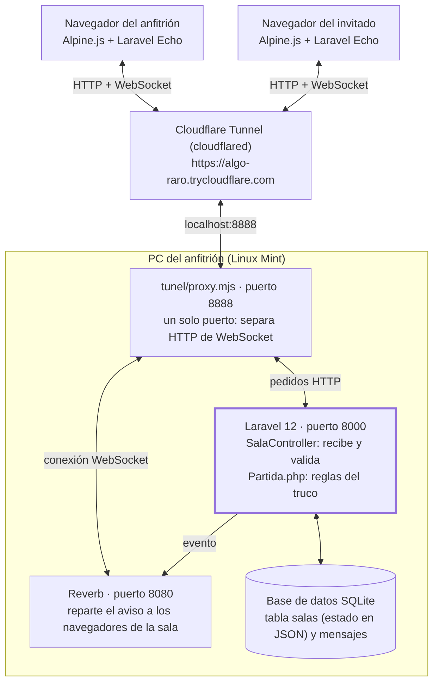
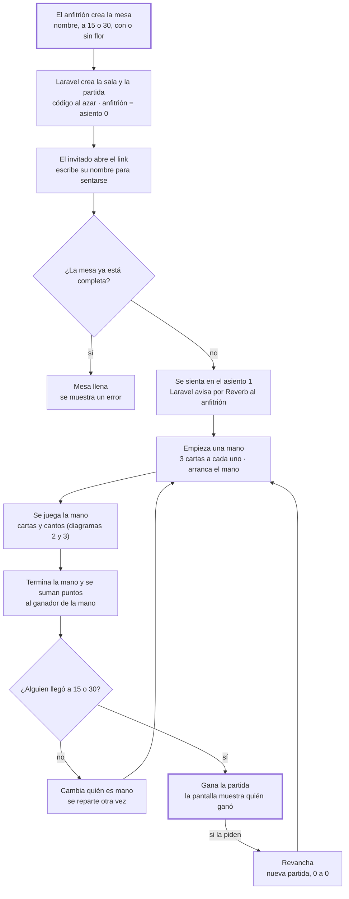
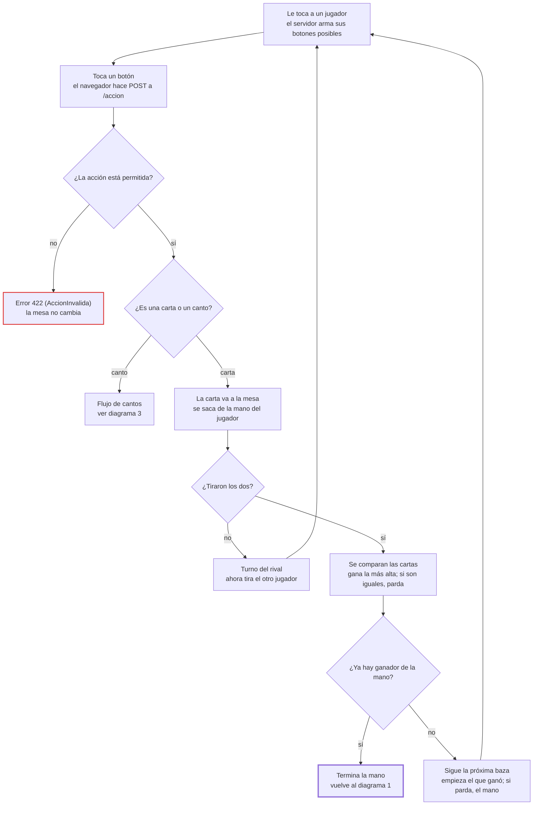
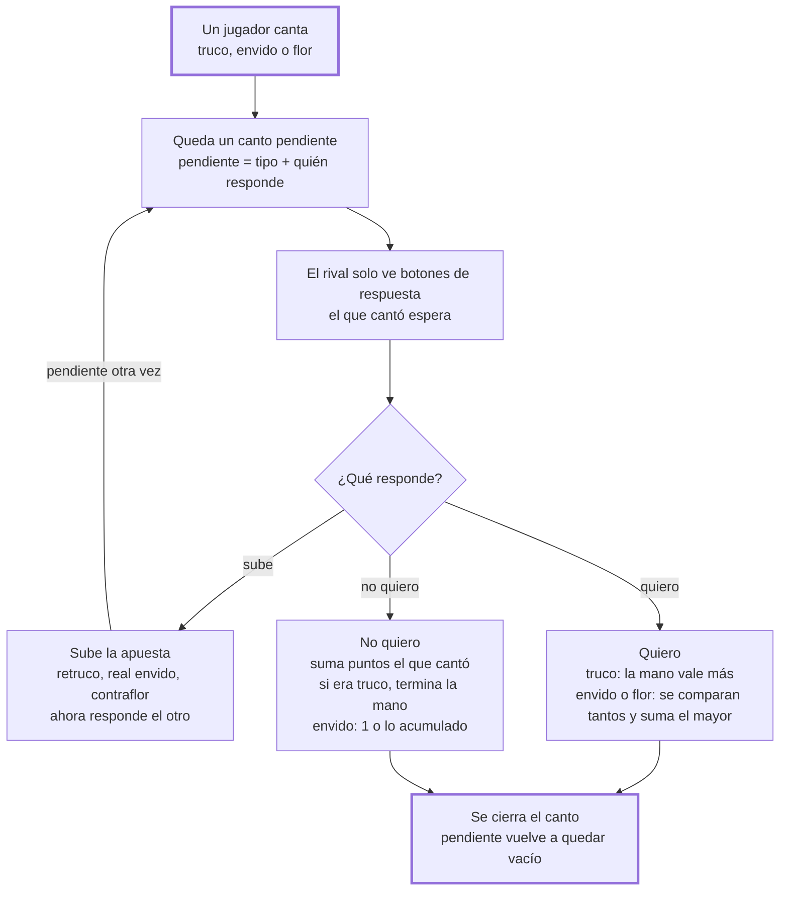
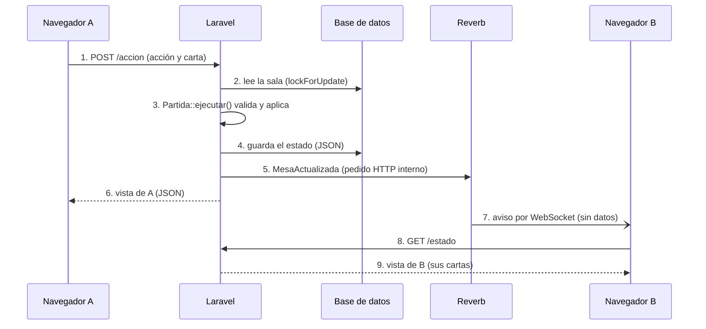

# Control de flujo de Vale 4 Hasta tu Saco

Documento para exponer en clase. Explica con diagramas cómo fluye el juego: la partida, el turno, los cantos y el viaje de cada jugada por WebSocket. Todo está basado en el código del repositorio.

> Los diagramas están escritos en [Mermaid](https://mermaid.js.org/). GitHub los dibuja solo cuando abrís este archivo en el repositorio.

## Índice

1. [Qué es el juego y cómo está armado](#1-qué-es-el-juego-y-cómo-está-armado)
2. [Diagrama 1: la partida completa](#2-diagrama-1-la-partida-completa)
3. [Diagrama 2: el turno y las bazas](#3-diagrama-2-el-turno-y-las-bazas)
4. [Diagrama 3: truco, envido y flor](#4-diagrama-3-truco-envido-y-flor)
5. [Diagrama 4: cómo viaja una jugada de una PC a la otra](#5-diagrama-4-cómo-viaja-una-jugada-de-una-pc-a-la-otra)
6. [Guion para exponer, preguntas y glosario](#6-guion-para-exponer-preguntas-y-glosario)

---

## 1. Qué es el juego y cómo está armado

Vale 4 Hasta tu Saco es un truco argentino para dos jugadores, cada uno en su PC, que ven la misma mesa al instante y chatean con frases del truco. Está hecho con Laravel 12 en el servidor, Reverb para los WebSockets, Laravel Echo y Alpine.js en el navegador, y un túnel de Cloudflare para jugar desde casas distintas.

Las flechas dobles son conexiones de ida y vuelta; la única flecha simple es el evento que Laravel le pasa a Reverb para que avise a los dos navegadores.

**La idea más importante del proyecto:** todas las reglas del truco viven en una sola clase, `app/Truco/Partida.php`, que no sabe nada de Laravel ni de la base de datos. El controlador solo le pasa la jugada, guarda el resultado y avisa. Eso permite probar las reglas sin levantar el servidor.

### Cómo leer los diagramas de flujo de este documento

Un diagrama de flujo dibuja el camino que sigue un programa: qué hace primero, qué pregunta se hace y a dónde va según la respuesta.

| Símbolo | Qué significa | Ejemplo en el juego |
| --- | --- | --- |
| Rectángulo | Un paso que hace el sistema o el jugador | Repartir 3 cartas a cada uno |
| Rombo | Una pregunta con dos salidas (sí o no) | ¿Algún jugador llegó al objetivo? |
| Flecha | El orden: a qué paso se va después | De "jugar carta" a "¿tiraron los dos?" |
| Caja con borde grueso | El inicio, el final o el paso central | Gana la partida |

**Para decir en clase:**

- "El servidor es la única autoridad: el navegador pide, el servidor decide si la jugada vale."
- "Un túnel gratis expone un solo puerto, por eso `proxy.mjs` manda los WebSockets a Reverb y todo lo demás a Laravel."
- "Para levantar todo junto alcanza con `composer run mesa` y después `cloudflared tunnel --url http://localhost:8888`."

---

## 2. Diagrama 1: la partida completa

Una partida se juega en manos: en cada mano se reparten 3 cartas nuevas, y eso se repite hasta que un jugador llega a 15 o a 30 puntos.

La columna principal es el camino normal; los desvíos son la mesa llena, otra mano y la revancha, y las flechas que vuelven a "Empieza una mano" son los ciclos.

**Observaciones: qué hace el código en cada paso**

| Paso | Dónde está | Qué conviene explicar |
| --- | --- | --- |
| Crear la mesa | `SalaController@crear`, `Sala::crear` | Valida el nombre (hasta 20 letras), el objetivo (15 o 30) y la flor. Guarda en la sesión que este navegador es el asiento 0. |
| Unirse | `SalaController@unirse` | Usa una transacción con `lockForUpdate()`: si dos personas entran a la vez, solo una se sienta. |
| Empieza una mano | `Partida::iniciarMano()` | Reparte, limpia la mesa y los cantos, y el turno es del mano. |
| Termina la mano | `Partida::terminarMano()` | Suma los puntos, guarda cómo quedó la mesa para mostrarla 4 segundos y cambia quién es mano. |
| ¿Llegó al objetivo? | `Partida::sumar()` | Se revisa cada vez que alguien suma, también por envido o flor: se puede ganar en la mitad de una mano. |
| Revancha | `SalaController@revancha` | Solo se permite si la partida terminó; crea una partida nueva con las mismas reglas. |

**Para decir en clase:**

- "No hay usuarios ni contraseñas. La sesión de Laravel guarda en qué asiento está cada navegador (0 o 1), y con eso el servidor sabe quién es quién."
- "El *mano* es el jugador que empieza la mano; se va turnando. En los empates de envido y flor gana el mano."
- "`lockForUpdate()` bloquea la fila de la sala mientras se modifica, así dos pedidos al mismo tiempo no se pisan."

**Pregunta que pueden hacer:** "¿Dónde se guarda la partida?" Respuesta: en la columna `estado` de la tabla `salas`, como JSON. `Partida::toArray()` la convierte en arreglo para guardarla y `Partida::desdeArray()` la vuelve a armar en cada pedido.

---

## 3. Diagrama 2: el turno y las bazas

Cada mano tiene hasta 3 bazas (las "rondas" de una carta por jugador), y la gana quien se lleva 2. Antes de cambiar nada, el servidor revisa si la acción está permitida en ese momento.

Las dos flechas que vuelven a "Le toca a un jugador" son los ciclos: una cuando falta que tire el rival y otra cuando empieza otra baza.

**Observaciones**

- **El servidor decide qué botones ves.** `Partida::accionesDisponibles()` arma la lista de lo que cada jugador puede hacer. La pantalla solo muestra esos botones, y `ejecutar()` vuelve a comprobarlo: si alguien manda una acción a mano (por ejemplo desde la consola del navegador), recibe un error 422 y la mesa no cambia.
- **Valor de las cartas.** Cada carta tiene un `valorTruco()` (en `Carta.php`): el 1 de espada es la más alta, después el 1 de basto, el 7 de espada, el 7 de oro, y así. Si las dos cartas valen lo mismo, la baza es *parda* (empate).

**Quién gana la mano** (`Partida::ganadorDeLaMano()`):

| Lo que pasó en las bazas | Gana la mano |
| --- | --- |
| Ganó 2 bazas | Ese jugador |
| Parda la primera | El que gane la segunda |
| Parda la segunda | El que ganó la primera |
| Una y una, y parda la tercera | El que ganó la primera |
| Las tres pardas | El mano |

**Para decir en clase:** "Un rombo es una pregunta. Cada rombo de este diagrama es un `if` en `Partida.php`: por ejemplo, '¿Tiraron los dos?' es `if (count($this->mesa[$baza]) < 2)`."

---

## 4. Diagrama 3: truco, envido y flor

Cuando alguien canta, la partida guarda un *canto pendiente* y nadie puede tirar cartas hasta que el rival responda. Truco, envido y flor siguen el mismo esquema; solo cambian los puntos.

La flecha que vuelve desde "Sube la apuesta" es el ida y vuelta de truco, retruco y vale cuatro: cada subida deja otro canto pendiente, ahora para el que había cantado primero.

**Cuánto vale cada canto** (según `Partida.php`):

| Canto | Si responden "Quiero" | Si responden "No quiero" |
| --- | --- | --- |
| Truco | la mano vale 2 | el que cantó suma 1 |
| Retruco | la mano vale 3 | suma 2 |
| Vale cuatro | la mano vale 4 | suma 3 |
| Envido | 2 al que tiene más tanto | 1 |
| Envido, envido | 4 | 2 |
| Real envido | suma 3 a lo que venía | lo que venía antes (1 si fue el primer canto) |
| Falta envido | lo que le falta al que va ganando | lo que venía antes (1 si fue el primer canto) |
| Flor (el rival no tiene) | 3 puntos sin responder | no hay respuesta |
| Con flor me achico | no aplica | el que cantó flor suma 4 |
| Contraflor | 6 al que tiene mejor flor | 4 |
| Contraflor al resto | lo que le falta al que va ganando | 6 si venía de contraflor, si no 4 |

**Observaciones**

- **Un estado, no muchos `if` sueltos.** La variable `$pendiente` guarda dos cosas: qué se cantó (`truco`, `envido` o `flor`) y quién tiene que responder. Mientras no esté vacía, `accionesDisponibles()` solo le da botones de respuesta a ese jugador y ninguno al otro.
- **"El envido está primero".** Si te cantan truco en la primera baza, podés contestar con envido. El truco queda en espera (`$trucoSuspendido`) y vuelve a quedar pendiente cuando se cierra el envido.
- **La flor le gana al envido.** Si se canta flor, el envido se anula. Y si tenés flor y se juega con flor, no podés cantar envido: tenés que cantar flor.
- **Cuándo se puede cantar.** Envido y flor, solo en la primera baza y antes de tirar tu carta. El truco lo sube solo quien tiene "el quiero", es decir, quien aceptó el último canto.
- **Empates.** Si los dos tienen el mismo tanto de envido o de flor, gana el mano.
- **Irse al mazo.** El rival suma lo que vale la mano. Si te vas en la primera baza sin que se haya cantado envido, el rival suma 1 punto más.

**Para decir en clase:** "Esto es una *máquina de estados*: el juego está en un estado (jugando o esperando una respuesta) y cada acción lo lleva a otro. Pensarlo así evita que se pueda tirar una carta en medio de un truco."

---

## 5. Diagrama 4: cómo viaja una jugada de una PC a la otra

El WebSocket solo lleva un aviso vacío de "algo cambió"; los datos de la mesa viajan siempre por HTTP, y cada jugador recibe únicamente lo que le corresponde ver.

Este es un *diagrama de secuencia*: cada columna es una parte del sistema, el tiempo corre hacia abajo y cada flecha es un mensaje. Solo el paso 7 viaja por WebSocket; en el paso 5 Laravel le entrega el evento a Reverb con un pedido HTTP interno.

| Paso | Qué pasa | Dónde está |
| --- | --- | --- |
| 1 | El jugador A toca un botón y Alpine manda un `fetch` POST con la acción y la carta | `mesa.blade.php`, función `enviar()` |
| 2 a 4 | En una transacción: bloquea la sala, arma la partida desde el JSON, la ejecuta y la guarda | `SalaController@accion` |
| 5 | Publica el evento en el canal público `sala.{codigo}` con el nombre `mesa.actualizada` | `app/Events/MesaActualizada.php` |
| 6 | A recibe su vista en la misma respuesta, no necesita esperar el aviso | `Sala::vistaPara()` |
| 7 | Reverb reenvía el aviso a todos los navegadores suscritos al canal | Echo: `Echo.channel(...).listen('.mesa.actualizada', ...)` |
| 8 y 9 | B pide `/estado` y recibe sus cartas; del rival solo sabe cuántas le quedan | `SalaController@estado` |

**Observaciones**

- **Por qué el aviso va vacío.** El canal es público: cualquiera que sepa el código podría escucharlo. Si el evento llevara la mesa completa, viajarían las cartas de los dos. Por eso `broadcastWith()` devuelve un arreglo vacío.
- **`ShouldBroadcastNow`.** El evento se envía en el momento, sin cola. Así no hace falta levantar un `queue:work` aparte.
- **El punto en `.mesa.actualizada`.** Como el evento define su propio nombre con `broadcastAs()`, en Echo se escucha con un punto adelante. Sin el punto, Echo le agrega `App\Events` y no lo encuentra.
- **Plan B si Reverb se cae.** La pantalla pide `/estado` cada 5 segundos con `setInterval`, y cuando la conexión vuelve pide el estado enseguida. En el servidor, `avisar()` tiene un `try/catch`: si Reverb no responde, la jugada vale igual.
- **El chat usa el mismo camino.** `POST /mensaje` guarda el texto en la tabla `mensajes` (hasta 200 caracteres y 30 mensajes por minuto) y dispara el mismo aviso. Las frases rápidas, como "¡Buenas!" o "¿Tenés el ancho?", están en `Mensaje::FRASES`, y los cantos del juego aparecen solos en el registro de la mesa.

**Para decir en clase:** "HTTP es preguntar, WebSocket es que te avisen. Acá usamos los dos: el aviso viaja por WebSocket y los datos por HTTP, así nadie puede ver las cartas del otro."

---

## 6. Guion para exponer, preguntas y glosario

### Orden sugerido para la exposición

1. **Arrancar con la demo.** Dos navegadores lado a lado (o el video del juego): tirar una carta en uno y mostrar que aparece sola en el otro. Eso engancha y presenta el problema.
2. **Arquitectura (sección 1).** Recorrer el dibujo de arriba hacia abajo: navegador, túnel, proxy, Laravel y Reverb.
3. **La partida completa (diagrama 1).** Explicar qué es una mano y dónde están los ciclos.
4. **El turno y las bazas (diagrama 2).** Mostrar que cada rombo es un `if` del código y la tabla de quién gana la mano.
5. **Los cantos (diagrama 3).** Presentar la idea de *máquina de estados* con `$pendiente`.
6. **La jugada viajando (diagrama 4).** Es el centro de la Unidad 4: evento, canal, Reverb y Echo. Remarcar por qué el aviso va vacío.
7. **Cierre.** Qué aprendiste y qué mejorarías (por ejemplo, usuarios con login y canales privados).

### Preguntas que pueden hacer

| Pregunta | Respuesta corta |
| --- | --- |
| ¿Por qué un canal público y no uno privado? | No hay usuarios con login, y el aviso no lleva datos. Las cartas solo salen por `/estado`, que exige la sesión del jugador. |
| ¿Qué pasa si los dos tocan un botón al mismo tiempo? | `lockForUpdate()` hace que esperen en fila. El segundo encuentra la mesa ya cambiada y, si no le toca, recibe un error 422. |
| ¿Se puede hacer trampa desde la consola del navegador? | No. El servidor revisa cada acción con las reglas, y el navegador nunca recibe las cartas del rival. |
| ¿Qué pasa si se corta la conexión? | La pantalla indica que no está en vivo y consulta cada 5 segundos; al reconectar pide el estado enseguida. |
| ¿Para qué el túnel? | Para que el invitado llegue a la PC del anfitrión sin abrir puertos del router. La dirección cambia cada vez que se levanta. |
| ¿Cómo probaste que las reglas andan? | Con tests automáticos en `tests/Unit/Truco` y `tests/Feature/SalaTest.php`, que se corren con `php artisan test`. |

### Glosario

| Término | Qué significa |
| --- | --- |
| Mano (la ronda) | Cada reparto de 3 cartas; se juega hasta que alguien gana 2 bazas. |
| Mano (el jugador) | El que empieza la ronda; gana los empates. Se alterna en cada mano. |
| Baza | Cada vuelta en la que los dos tiran una carta. Hay hasta 3 por mano. |
| Parda | Empate en una baza: las dos cartas valen lo mismo. |
| Tanto | Los puntos de envido o de flor que suman tus cartas. |
| Canto pendiente | Un truco, envido o flor que todavía no tiene respuesta; frena el juego. |
| HTTP | El navegador pregunta y el servidor contesta. |
| WebSocket | Una conexión que queda abierta para que el servidor avise sin que le pregunten. |
| Evento de broadcasting | Una clase de Laravel que se publica en un canal (`MesaActualizada`). |
| Canal | El "tema" al que se suscribe el navegador, acá `sala.{codigo}`. |
| Reverb | El servidor de WebSockets de Laravel (puerto 8080). |
| Echo | La librería de JavaScript que escucha los eventos de Reverb. |
| Alpine.js | Librería chica de JavaScript que actualiza la pantalla cuando cambian los datos. |
| Transacción | Un grupo de operaciones en la base de datos que se hacen todas o ninguna. |
| Túnel | Un servicio que le da a tu PC una dirección pública de internet (Cloudflare Tunnel). |
